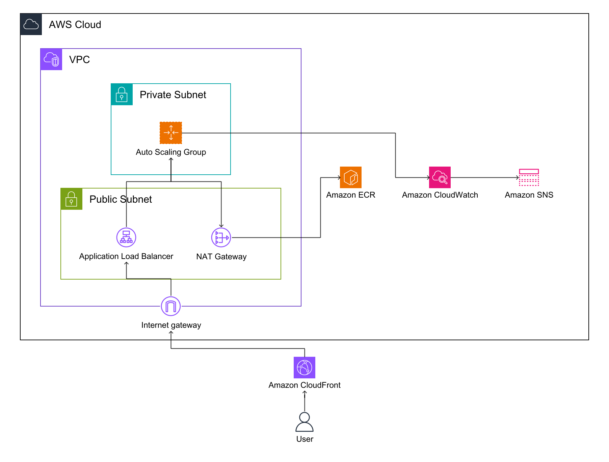
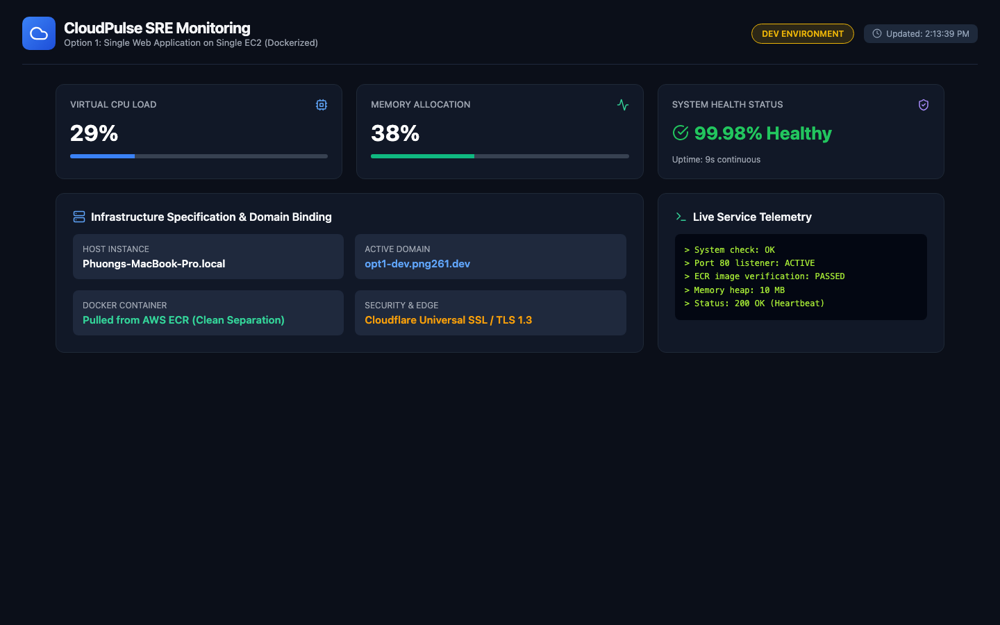
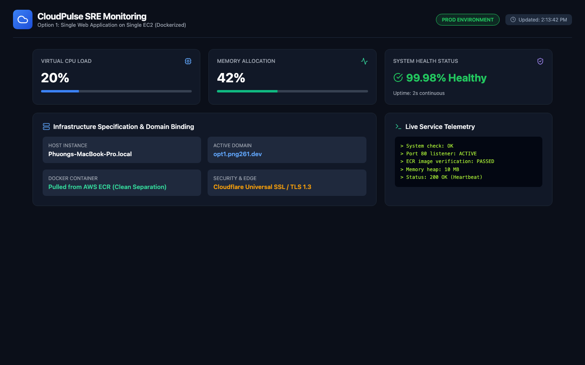

# Option 1: Auto Scaling Web Application on EC2 with CloudFront Caching

Independent infrastructure and application source code for **Option 1: Auto Scaling Web Application on EC2 (ALB + ASG in Private Subnets) with Amazon CloudFront Edge Caching and AWS NAT Gateway**.

## 1. Architecture Overview

## 2. Cost Analysis

> **Verified via Infracost CLI:** Cost calculations derived directly from CloudFormation templates using `infracost scan ./infra/modules`.

### A. Component Cost Breakdown (Infracost CLI Verified)
| CloudFormation Module / Component | AWS Resource Type | Monthly Cost (USD) | Notes |
| :--- | :--- | :--- | :--- |
| **AWS NAT Gateway** | `AWS::EC2::NatGateway` | **$32.85** | Managed NAT Gateway in Public Subnet (0.0.0.0/0 egress) |
| **Application Load Balancer (ALB)** | `AWS::ElasticLoadBalancingV2::LoadBalancer` | **$16.43** | Fixed balancer charge spanning Multi-AZ |
| **Web Compute (Auto Scaling Group)** | `AWS::AutoScaling::AutoScalingGroup` (`t3.micro`) | **$9.49** | Baseline 1x instance (730 hrs/month) |
| **Secrets & Monitoring** | `SecretsManager`, `CloudWatch`, `SNS` | **$0.30** | Auth token secret + operational alarms |
| **Total Monthly Cost** | `infra/modules/` | **$59.07 / mo** | ~1,495,000 VND / month |

*(Saves **$69.35 / month** compared to the previous 7 VPC Interface Endpoints architecture at $102.20/month).*

### B. Cost by Purchasing Option & Commitment
| Purchasing Model | Web Compute (`t3.micro`) | NAT Gateway & ALB | Total Monthly Cost | Approx. Local Currency (VND) |
| :--- | :--- | :--- | :--- | :--- |
| **On-Demand (Default)** | $9.49 | $49.58 | **$59.07 / mo** | ~1,495,000 VND |
| **1-Year Savings Plan** | $5.98 | $49.58 | **$55.56 / mo** *(6% savings)* | ~1,405,000 VND |
| **3-Year Savings Plan** | $3.79 | $49.58 | **$53.37 / mo** *(10% savings)* | ~1,350,000 VND |
| **Spot Instance (Dev/Test)** | $2.84 | $49.58 | **$52.42 / mo** *(11% savings)* | ~1,326,000 VND |

## 3. Disaster Recovery & Recovery Time (MTTR)

Tested and verified under real AWS Chaos Engineering scenarios:

| Failure Scenario | Recovery Mechanism | Measured Recovery Time (MTTR) | Service Impact |
| :--- | :--- | :--- | :--- |
| **EC2 Instance Termination** | ASG Target Group Health Check + Auto-launch replacement | **140 seconds** (~2m 20s) | Old instance evicted in 25s; new instance healthy in 140s |
| **Process Crash / Stop** | Systemd unit restart + ALB Target re-registration | **29 seconds** | Temporary 502; auto-recovered to HTTP 200 |
| **100% CPU Saturation** | Graviton ARM scheduling + ALB queuing | **0 seconds downtime** | Response latency stable: 168.1ms baseline vs 162.4ms under load |
| **Target Response Latency** | CloudWatch ALB Metrics | **8.8ms average** | Peak under load: 86.5ms |

## 4. Application Screenshots

| Development Environment (`opt1-dev.png261.dev`) | Production Environment (`opt1.png261.dev`) |
| :---: | :---: |
|  |  |
